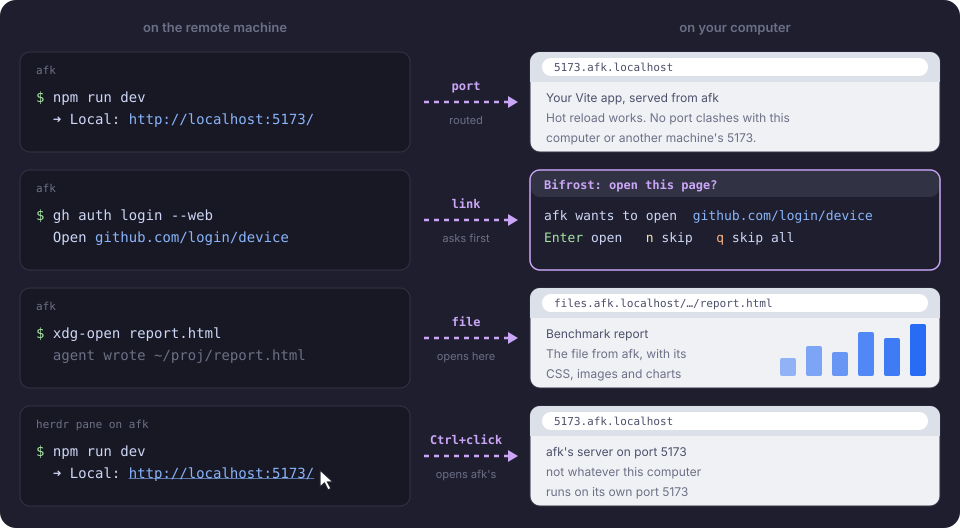

# bifrost

[](https://github.com/kujjwal02/bifrost/actions/workflows/ci.yml)
[](https://herdr.dev/plugins/)
[](LICENSE)

A [herdr](https://herdr.dev) plugin for agents on remote machines. Their dev servers, the links they open
and the files they write show up in the browser on the computer you sit at, with nothing to forward by hand.
Named after the rainbow bridge between worlds in Norse myth.



bifrost reuses the SSH details herdr already has. It needs no server, account or VPN, and installs nothing
on the remote unless you run `bifrost setup`. [How it works](docs/architecture.md) has the design and diagrams.

## Install

You need herdr 0.9.0 or newer, Python 3.10 or newer, and OpenSSH, on macOS or Linux (WSL is experimental).
Each remote must be Linux, saved in herdr as a [machine](https://herdr.dev/docs/remote/) that logs in with a
key and no prompt.

```sh
herdr plugin install kujjwal02/bifrost
herdr plugin action invoke kujjwal02.bifrost.install-cli   # optional: `bifrost` in ~/.local/bin
bifrost setup afk                                          # once per machine, for links and files
```

The daemon starts with herdr. Bind the status popup to a key in `~/.config/herdr/config.toml`:

```toml
[[keys.command]]
key = "prefix+f"
type = "plugin_action"
command = "kujjwal02.bifrost.status"
description = "bifrost ports"
```

## Ports

Every port a machine listens on opens about a second later at `http://<port>.<machine>.localhost`.
`<machine>` is the herdr machine label, so `herdr machine rename <id> --label afk` gives `*.afk.localhost`.
Two machines can both run port 3000. WebSockets and hot reload work, and browsers resolve `*.localhost`
without DNS. `http://localhost/` lists every route.

bifrost routes listeners that belong to your SSH user, on loopback or a wildcard address, port 1024 or higher.
For a tool that insists on `localhost:<port>`, such as an OAuth callback or an https dev server, run
`bifrost forward afk:1455`.

## Links the remote opens


After `bifrost setup afk`, a link that an agent opens on afk opens here. `xdg-open`, `$BROWSER`, `gh` and
the npm `open` package all go through it.

- The machine's own pages (`http://localhost:<port>`) and files open at once.
- Any other page waits for a yes in a herdr popup, so a prompt-injected agent cannot open a phishing page
  on your computer without you. Press Enter to open, `n` to skip, `q` to skip all.
- More than 5 automatic opens in a minute also go to the popup.

## Remote files


`xdg-open report.html` on afk, or `bifrost open afk:~/proj/report.html` here, opens the file with its CSS
and images. Each reload reads the file again. Links are signed and stay inside their folder; see
[SECURITY.md](SECURITY.md).

## Ctrl+click in herdr


Ctrl+click a `http://localhost:5173` link in a remote pane, and bifrost opens afk's server, not whatever
listens on this computer's port 5173.

## Commands

| Command | Does |
| --- | --- |
| `bifrost status` | list machines, routed ports and their URLs |
| `bifrost setup <machine>` / `--undo` | install or remove the opener on a machine |
| `bifrost open <machine>:<path>` | open a remote file in this browser |
| `bifrost forward <machine>:<port>` / `--stop` | add or remove a same-port `localhost:<port>` forward |
| `bifrost logs [-f]` | show or follow the daemon log |
| `bifrost restart` | reconnect every machine |

`bifrost --help` lists the rest.

## Configuration

Optional. Put `config.json` in the folder `herdr plugin config-dir kujjwal02.bifrost` prints, then run
`bifrost restart`:

```json
{"min_port": 3000, "ignored_ports": [9119], "router_port": 8000, "log_level": "debug"}
```

| Key | Default | Meaning |
| --- | --- | --- |
| `min_port` | `1024` | lowest port to route |
| `ignored_ports` | `[]` | ports never routed |
| `ignored_process_prefixes` | editor and sync helpers | process names never routed |
| `router_port` | `80` | the router's port; any other value appears in URLs |
| `log_level` | `info` | `debug`, `info` or `warning` |
| `trusted_peers` | `[]` | extra addresses the router accepts, for WSL |

## Troubleshooting

| Symptom | Fix |
| --- | --- |
| a machine shows `retrying` | `ssh <target> true` must log in without a prompt |
| a port is missing | the server must listen on loopback or `0.0.0.0` as your user |
| `http://localhost/` does not load | another program holds port 80; set `router_port` |
| links on the remote open there | run `bifrost setup <machine>`, then restart the remote shell and agent |
| the daemon is down | `bifrost status` prints the last crash; `bifrost logs` has the rest |

## Uninstall

```sh
bifrost setup --undo afk          # for each machine you set up
bifrost stop
herdr plugin uninstall kujjwal02.bifrost
rm ~/.local/bin/bifrost
```

## Credits

The connection design follows [herdr-autofwd](https://github.com/entrptaher/herdr-autofwd) and
[herdr-portfwd](https://github.com/miko-misa/herdr-portfwd). Licensed [MIT](LICENSE).
