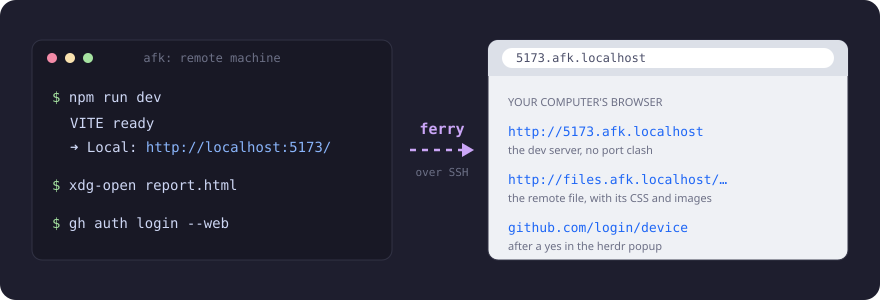
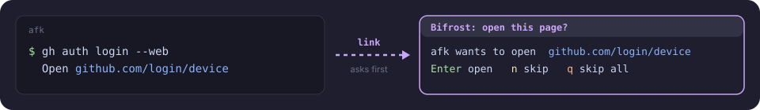
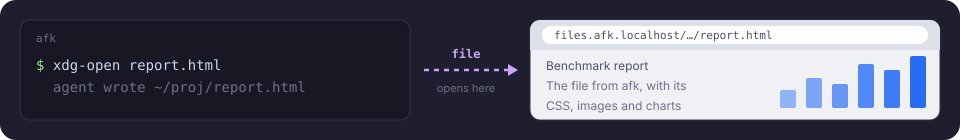
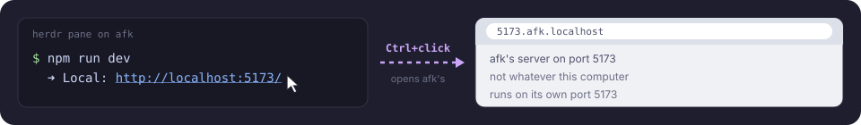

# ferry

[](https://github.com/kujjwal02/ferry/actions/workflows/ci.yml)
[](https://herdr.dev/plugins/)
[](LICENSE)

A [herdr](https://herdr.dev) plugin for agents on remote machines. Their dev servers, the links they open
and the files they write show up in the browser on the computer you sit at, with nothing to forward by hand.



- **Ports.** Every port a saved machine listens on opens about a second later at
  `http://<port>.<machine>.localhost`. Two machines can both run port 3000; each URL names its machine.
- **Links.** When an agent runs `xdg-open`, `gh auth login --web` or a dev server's `--open`, the page opens here.
- **Files.** `xdg-open report.html` on the remote opens the file here, with its CSS and images.
- **Ctrl+click.** A `http://localhost:5173` link in a remote pane opens that machine's server.

ferry needs no server, account or VPN. It reuses the SSH connection details herdr already has, and installs
nothing on the remote unless you run `ferry setup`.

## Requirements

| Where | Needs |
| --- | --- |
| This computer | herdr 0.9.0 or newer, Python 3.10 or newer, OpenSSH. macOS or Linux; WSL is experimental. |
| Each remote machine | Linux, reachable as a [herdr saved machine](https://herdr.dev/docs/remote/) with key login (no password prompt). |

Browsers resolve every `*.localhost` name to loopback themselves, so no DNS or `/etc/hosts` change is needed.

## Install

```sh
herdr plugin install kujjwal02/ferry
herdr plugin action invoke kujjwal02.ferry.install-cli   # optional: a `ferry` command in ~/.local/bin
```

The daemon starts with the next herdr server start or workspace switch. To start it now, run `ferry start`.

Bind the status popup to a key in `~/.config/herdr/config.toml`:

```toml
[[keys.command]]
key = "prefix+f"
type = "plugin_action"
command = "kujjwal02.ferry.status"
description = "ferry ports"
```

## Quick start

```sh
herdr machine rename <id> --label afk   # the label becomes the URL name: *.afk.localhost
ferry status                            # machines, ports and their URLs
ferry setup afk                         # once: links and files that afk opens come here
```

Then on the remote, run `npm run dev` and open `http://5173.afk.localhost`. To list every route in the
browser, open `http://localhost/`.

## Ports

ferry watches each enabled saved machine and routes every listener that:

- belongs to the SSH user,
- listens on loopback or a wildcard address, IPv4 or IPv6,
- uses port 1024 or higher.

When the server stops, its URL goes away. A notification names new ports, at most one per machine every 10 s.
WebSockets and Vite hot reload work through the route. Vite allows `.localhost` hosts by default.

`<machine>` is the herdr machine label in lowercase, with each run of other characters turned into `-`.
Two machines whose labels give the same name: ferry routes the first and logs the second.

Some tools insist on `localhost:<port>`: an OAuth callback, or an https dev server. Give such a tool a
same-port forward:

```sh
ferry forward afk:1455          # localhost:1455 here reaches afk:1455
ferry forward --stop afk:1455
```

The forward binds `127.0.0.1` and lasts until the connection drops.

## Links the remote opens



`ferry setup afk` installs a small opener script on afk as `~/.local/share/ferry/bin/xdg-open`. It also
sets `PATH` and `BROWSER` in the rc file of your login shell there. Restart the shells and agents on afk
afterwards. If that rc file is a symlink (a dotfiles manager), ferry leaves it alone and prints the two
lines to add yourself.

| What the remote opens | What happens here |
| --- | --- |
| `http://localhost:<port>/...` (or `127.0.0.1`, `0.0.0.0`, `::1`) | opens at once as `http://<port>.<machine>.localhost/...` |
| a file, or a `file://` URL | opens at once as a file link |
| any other URL (`https://github.com/login/device`, ...) | waits for a yes in the "open this page?" popup |
| `https://localhost:<port>` | not opened; a notification suggests `ferry forward` |

A prompt-injected agent could otherwise open a phishing page on your computer with no click, so outside
pages wait for the popup. In the popup, press Enter or `y` to open, `n` or Esc to skip, or `q` to skip all.
The popup drops a page after 10 minutes without an answer. More than 5 automatic opens from one machine in
a minute also go to the popup.

The opener handles tools that call `xdg-open` from `PATH` and tools that read `$BROWSER` (Python
`webbrowser`, `gh`, the npm `open` package). It passes anything else to the system `xdg-open`: another
scheme, a path that is not a file, or a machine that no computer watches.

When two computers watch the same machine, the one whose herdr shows that machine opens the page.

## Remote files



```sh
ferry open afk:~/project/report.html
```

On the remote, `xdg-open report.html` does the same. The page loads at
`http://files.afk.localhost/<signature>/<folder>/report.html`, so its relative links (CSS, images, other
pages in the folder) load too. Each request reads the file again, so a reload shows the current version.
See [SECURITY.md](SECURITY.md) for how file links stay inside their folder.

## Localhost links in herdr



A server on the remote prints `http://localhost:5173`. Ctrl+click it in herdr, and ferry opens
`http://5173.afk.localhost` when the machine herdr shows listens on that port. Otherwise the link opens
unchanged. herdr passes link clicks to plugins only while `ui.mouse_capture` is on, its default.

## Commands

| Command | Does |
| --- | --- |
| `ferry status` | list machines, routed ports and their URLs |
| `ferry setup <machine>` / `--undo` | install or remove the opener on a machine |
| `ferry open <machine>:<path>` | open a remote file in this browser |
| `ferry forward <machine>:<port>` / `--stop` | add or remove a same-port `localhost:<port>` forward |
| `ferry logs [-n 50] [-f]` | show or follow the daemon log |
| `ferry start` / `stop` / `restart` | control the daemon; herdr starts it for you |
| `ferry install-cli [--bin-dir DIR]` | put a `ferry` command on PATH |

`ferry --help` and `ferry <command> --help` give the details. Without the CLI, use the herdr actions
`kujjwal02.ferry.status` and `kujjwal02.ferry.restart`.

## Configuration

Optional. Create `config.json` in the directory `herdr plugin config-dir kujjwal02.ferry` prints:

```json
{
  "min_port": 3000,
  "ignored_ports": [9119],
  "ignored_process_prefixes": ["code-", "cursor-", "windsurf-", "syncthing"],
  "router_port": 80,
  "log_level": "info",
  "trusted_peers": []
}
```

| Key | Default | Meaning |
| --- | --- | --- |
| `min_port` | `1024` | lowest port to route |
| `ignored_ports` | `[]` | ports never routed |
| `ignored_process_prefixes` | editor and sync helpers | process names never routed |
| `router_port` | `80` | the router's port; any other value appears in URLs, as in `http://5173.afk.localhost:8000` |
| `log_level` | `info` | `debug` logs every request, file read and remote message; `warning` logs less |
| `trusted_peers` | `[]` | extra peer addresses the router accepts, for a WSL setup whose Windows connections do not arrive from loopback |

Run `ferry restart` after a change. If a key or value is unknown, the daemon stops, and `ferry status` lists
the valid ones.

## Platforms

| This computer | Opens pages with | Router |
| --- | --- | --- |
| macOS | `open` | port 80 on all addresses, with non-loopback peers refused |
| Linux | the system `xdg-open` | loopback, port 80 if `net.ipv4.ip_unprivileged_port_start` allows it, else 8080 |
| WSL (experimental) | `wslview`, else `explorer.exe`, so pages open in the Windows browser | as Linux |

On Linux, `curl` and other non-browser tools may need `--resolve` or an `/etc/hosts` line for `*.localhost`.
On WSL, a Windows browser reaches the router through WSL's localhost forwarding or mirrored networking. If
pages do not load there, set `"log_level": "debug"`. The log then names each refused peer address; add it to
`trusted_peers`.

## Troubleshooting

| Symptom | Check |
| --- | --- |
| a machine shows `retrying` | run `ssh <target> true`; it must log in without a prompt |
| a port is missing | `ferry status`; the server must listen on loopback or `0.0.0.0` as your user, port 1024 or higher |
| `http://localhost/` does not load | another program holds port 80; set `router_port` |
| links on the remote open there, not here | run `ferry setup <machine>`, then restart the remote shell and agent |
| the daemon is down | `ferry status` prints the last crash; `ferry logs` has the rest |

The log is in herdr's state directory for the plugin (`~/.local/state/herdr/plugins/kujjwal02.ferry/`). It
rotates at 1 MB and keeps 3 old files. If the daemon dies, the next workspace switch starts it again.

## How it works

| Piece | Runs on | Job |
| --- | --- | --- |
| `ferry.py daemon` | this computer, one per user | reads `herdr machine list` every 2 s; keeps one SSH master per enabled machine; adds and removes forwards with `ssh -O forward` |
| router | this computer, port 80 | reads the `Host` header, then copies raw bytes to that port's forward |
| `watch.sh` | each machine, over the SSH master | reads `/proc/net/tcp` and `/proc/net/tcp6` each second and reports changed listeners and queued links |
| `remote-open.sh` | each machine, as `xdg-open` | queues a link or file for `watch.sh` while a computer watches |

Each remote port gets a unix-socket forward under `~/.ssh/sockets/`, mode 0600. A unix socket cannot clash
with a local port, so every route works even when this computer uses the same port. The SSH master overrides
`RemoteCommand`, `RequestTTY` and configured forwards, so your `~/.ssh/config` cannot break it. The daemon
exits when its herdr server goes away; the remote watcher exits within a second after that.

## Uninstall

```sh
ferry setup --undo afk          # for each machine you set up
ferry stop
herdr plugin uninstall kujjwal02.ferry
rm ~/.local/bin/ferry
```

## Credits

The connection design follows [herdr-autofwd](https://github.com/entrptaher/herdr-autofwd) (one SSH master
per machine, streamed listeners) and [herdr-portfwd](https://github.com/miko-misa/herdr-portfwd) (never
renumber a port).

## License

[MIT](LICENSE)
