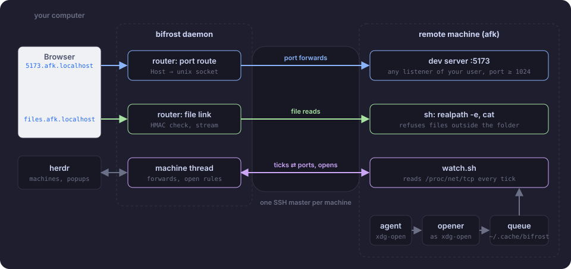
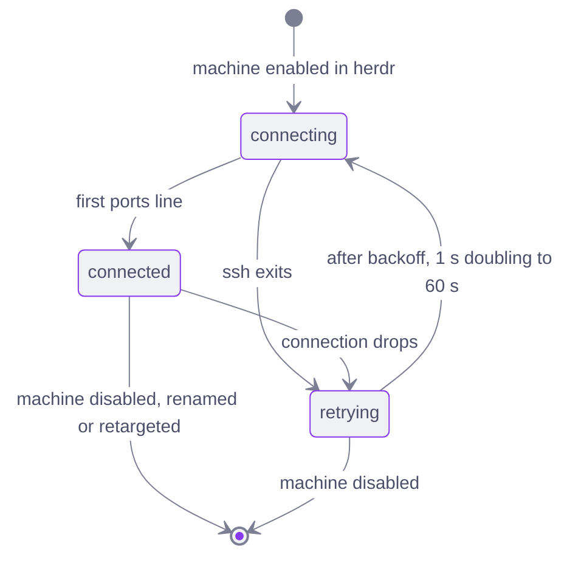
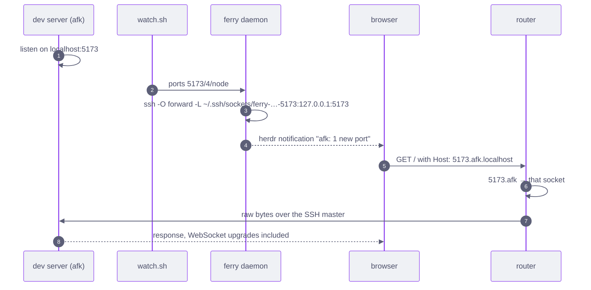
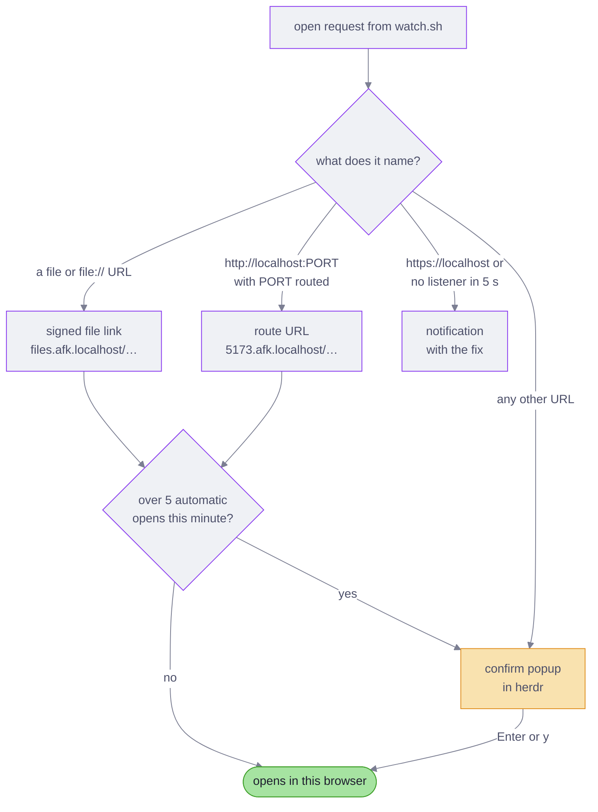
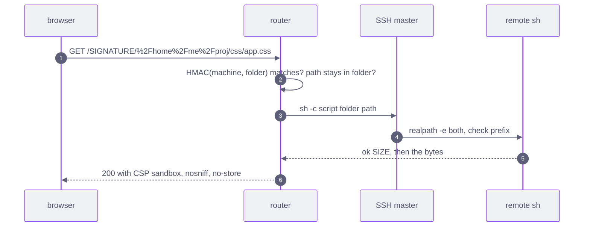
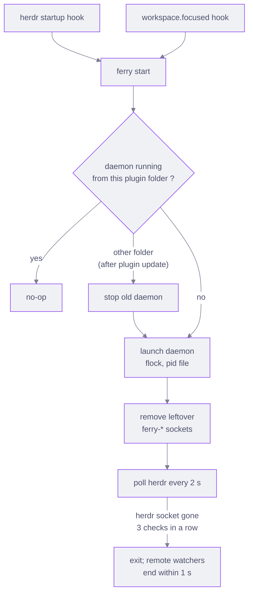
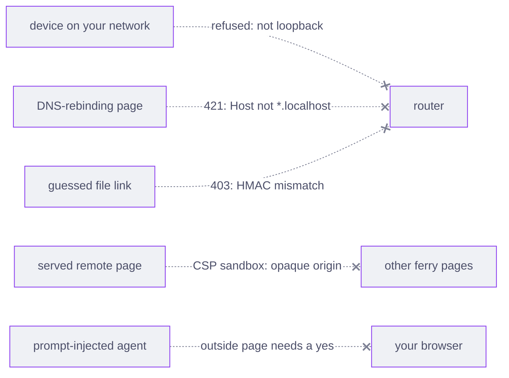

# How ferry works

ferry runs as one daemon on your computer. It holds one SSH connection to each enabled herdr saved machine,
and the connection carries everything else: listener reports, port forwards, open requests and file reads.
Nothing on the remote listens on a network port. The remote needs a POSIX shell and coreutils, plus `ss`
for process names.

## Pieces

| Piece | Runs on | Job |
| --- | --- | --- |
| `ferry` | your computer | sh launcher; finds Python 3.10 or newer and runs `ferry.py` |
| `ferry.py daemon` | your computer, one per user (flock) | follows `herdr machine list`, runs one `Machine` thread per enabled machine, hosts the router |
| router | inside the daemon, port 80 | matches the `Host` header to a route, then copies raw bytes both ways |
| `watch.sh` | each machine, as `sh -c` over SSH | reports listeners and queued open requests once a second |
| `remote-open.sh` | each machine, as `xdg-open` and `$BROWSER` | queues a URL or file while a computer watches, else runs the real `xdg-open` |
| `herdr-plugin.toml` | herdr | starts the daemon, binds the status and confirm popups, routes Ctrl+click |

## One connection per machine

The daemon starts the SSH master with `ssh -M` and its own control socket, then sends `watch.sh` as the
remote command. Every later step reuses that master: `ssh -O forward`, `ssh -O cancel`, and the short
commands that read files or install the opener. Those commands pass `ProxyCommand=/usr/bin/false`, so
they fail instead of dialling a new connection when the master is gone.

The master overrides `RemoteCommand`, `RequestTTY` and configured forwards, so a `~/.ssh/config` written
for interactive use cannot break it. Keys must work without a prompt (`BatchMode=yes`).

A connection that stayed up for 60 s resets the backoff to 1 s. Renaming a machine changes its URL name,
so the daemon rebuilds that machine from scratch.

## The watch protocol

The daemon writes a tick to `watch.sh` on stdin every second. `watch.sh` rescans on each tick and answers
with one line. When ticks stop, `read` fails and the watcher exits, so a dead daemon never leaves a
watcher behind that claims open requests.

| Direction | Line | Meaning |
| --- | --- | --- |
| daemon to remote | `tick 1` or `tick 0` | rescan; `1` when this computer's herdr shows the machine |
| remote to daemon | `ports 5173/4/node 8000/6/python3` | the listener set changed: port, IP family, process name |
| remote to daemon | `open http://localhost:5173/` | the opener queued a URL or an absolute file path |
| remote to daemon | empty line | nothing changed; the loop is alive |
| remote to daemon | `fatal REASON` | the machine cannot be watched, for example no `/proc/net/tcp` |

The daemon checks every line against a strict pattern before use. A bad line is logged and dropped.

`watch.sh` reports a listener only if the SSH user owns it, it listens on loopback or a wildcard
address, and its port is `min_port` or higher. One `awk` program reads `/proc/net/tcp` and
`/proc/net/tcp6`. When a port listens on both families, IPv4 wins, because the forward then targets
`127.0.0.1`.

## Routing a port

Each forward is a unix socket, mode 0600, under `~/.ssh/sockets/`. A unix socket cannot clash with a local
TCP port, which is why `5173.afk.localhost` works while this computer, or another machine, also uses
port 5173. Browsers resolve every `*.localhost` name to loopback without DNS.

The router reads the request head only up to the blank line, picks the route from `Host`, and then copies
bytes without parsing them. WebSockets and server-sent events pass through unchanged. A forward that
fails is retried every 5 s. A listener that moves from IPv4 to IPv6 gets a new forward.

`ferry forward afk:1455` adds a TCP forward on `127.0.0.1:1455` through the same master, for tools that
insist on `localhost:<port>`.

## Opening what the remote opens

The opener on the remote writes each request to `~/.cache/ferry/open.<pid>.<time>` (mode 0600, via a
`.partial` file and `mv`). It does so only while a `watching.*` heartbeat file is under 3 s old; otherwise
it runs the system `xdg-open`. `watch.sh` claims a request with `mv`, so when two computers watch the
same machine, exactly one opens it. A computer whose herdr does not show that machine waits 2 s before it
claims, which lets the computer you are looking at win.

Pending pages live in `pending-opens.json` in the state directory, under a file lock. The daemon opens
the herdr confirm popup with `herdr plugin pane open` and drops pages older than 10 minutes.

## Serving a remote file

A file link names a folder, not a file. The folder is one percent-encoded path segment, so a page's
relative links (`css/app.css`, `img/chart.png`, `../` within the folder) resolve to more links in the same
signed folder. The signature is an HMAC-SHA256 of the machine name and folder, keyed by
`file-link.key` in the state directory, so links survive daemon restarts but no web page can forge one.

The remote resolves symlinks with `realpath -e` and refuses a file that lands outside the folder (403) or
does not exist (404). The router streams the bytes in 64 KB chunks, so a large file does not grow the
daemon's memory.

## Daemon lifecycle

herdr does not supervise plugin processes, so ferry supervises itself:

- **Crash:** the next workspace switch runs `ferry start`, which finds no live daemon and launches one.
- **Update:** `herdr plugin update` installs into a new folder. The next hook run sees a daemon from the
  old folder and replaces it. It also repoints the `ferry` shim from `ferry install-cli`.
- **herdr exits:** the daemon exits after three failed checks of the herdr socket.
- **Errors:** an error in one connection, open request or router request is logged, and only that piece
  retries.

`daemon.log` rotates at 1 MB and keeps 3 old files. `crash.log` holds only what logging cannot catch, such
as a hard Python crash, and is cleared on every start.

## Security model

[SECURITY.md](../SECURITY.md) lists each threat, its defence, and what ferry does not defend against.

## Platforms

| This computer | Opens pages with | Router listens on |
| --- | --- | --- |
| macOS | `open` | port 80 on all addresses, because macOS lets a normal user bind a low port only there; non-loopback peers are closed unread |
| Linux | the system `xdg-open`, skipping the ferry opener | loopback, port 80 if `net.ipv4.ip_unprivileged_port_start` allows it, else 8080 (logged with the `sysctl` fix) |
| WSL (experimental) | `wslview`, else `explorer.exe`, so pages open in the Windows browser | as Linux |

On Linux, `curl` and other non-browser tools may need `--resolve` or an `/etc/hosts` line for
`*.localhost`. On WSL, a Windows browser reaches the router through WSL's localhost forwarding or mirrored
networking. If pages do not load there, set `"log_level": "debug"`; the log names each refused peer
address, which then goes in `trusted_peers`.

## Files

| Path | Holds |
| --- | --- |
| `~/.config/herdr/plugins/config/kujjwal02.ferry/config.json` | optional settings |
| `~/.local/state/herdr/plugins/kujjwal02.ferry/` | `daemon.log`, `crash.log`, `status.json`, `daemon.pid`, `file-link.key`, `pending-opens.json` |
| `~/.ssh/sockets/ferry-*` | control sockets and per-port forwards |
| remote `~/.cache/ferry/` | heartbeats and the open queue, mode 0700 |
| remote `~/.local/share/ferry/bin/xdg-open` | the opener, from `ferry setup` |
